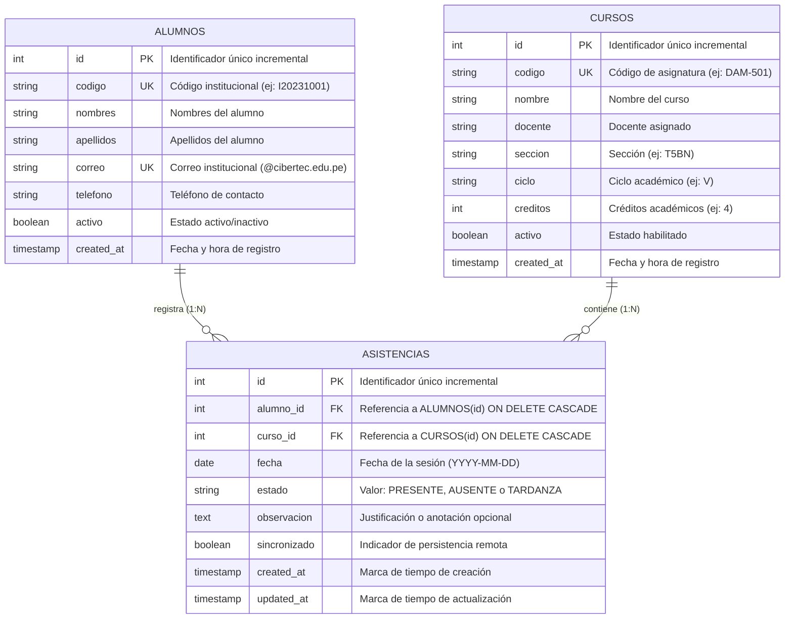

# Diagrama Entidad-Relación y Modelo de Datos — Asiste+

## 1. Descripción del Negocio
El sistema **Asiste+** gestiona el control de asistencia estudiantil para asignaturas académicas en Cibertec.
- Un **alumno** puede estar registrado en múltiples asistencias a lo largo de las sesiones del ciclo académico.
- Un **curso** contiene múltiples sesiones de clase donde se registra la asistencia.
- Una **asistencia** pertenece exactamente a un alumno y a un curso en una fecha determinada.
- **Regla de negocio crítica de unicidad:** Un estudiante no puede tener más de un registro de asistencia en el mismo curso para la misma fecha (restricción `UNIQUE(alumno_id, curso_id, fecha)`).

---

## 2. Diagrama Entidad-Relación (Mermaid)



---

## 3. Modelo Lógico

### ALUMNOS
- `id` (Entero, Clave Primaria, Autoincremental)
- `codigo` (Cadena de 20 caracteres, No Nulo, Único)
- `nombres` (Cadena de 100 caracteres, No Nulo)
- `apellidos` (Cadena de 100 caracteres, No Nulo)
- `correo` (Cadena de 120 caracteres, No Nulo, Único)
- `telefono` (Cadena de 20 caracteres, Opcional)
- `activo` (Booleano, Por defecto: Verdadero)
- `created_at` (Marca de tiempo, Por defecto: Tiempo actual)

### CURSOS
- `id` (Entero, Clave Primaria, Autoincremental)
- `codigo` (Cadena de 20 caracteres, No Nulo, Único)
- `nombre` (Cadena de 120 caracteres, No Nulo)
- `docente` (Cadena de 120 caracteres, No Nulo)
- `seccion` (Cadena de 20 caracteres, Por defecto: 'T5BN')
- `ciclo` (Cadena de 20 caracteres, Por defecto: 'V')
- `creditos` (Entero, Por defecto: 4)
- `activo` (Booleano, Por defecto: Verdadero)
- `created_at` (Marca de tiempo, Por defecto: Tiempo actual)

### ASISTENCIAS
- `id` (Entero, Clave Primaria, Autoincremental)
- `alumno_id` (Entero, Clave Foránea referenciando a `ALUMNOS.id`, No Nulo, Cascada al eliminar)
- `curso_id` (Entero, Clave Foránea referenciando a `CURSOS.id`, No Nulo, Cascada al eliminar)
- `fecha` (Fecha, Formato ISO YYYY-MM-DD, No Nulo)
- `estado` (Cadena, Restricción CHECK: `PRESENTE`, `AUSENTE`, `TARDANZA`)
- `observacion` (Texto, Opcional)
- `sincronizado` (Booleano, Por defecto: Verdadero en servidor)
- `created_at` (Marca de tiempo, Por defecto: Tiempo actual)
- `updated_at` (Marca de tiempo, Por defecto: Tiempo actual)
- **Restricción de Unicidad Compuesta:** `UNIQUE(alumno_id, curso_id, fecha)`

---

## 4. Modelo Físico en SQLite (Dispositivo Móvil Android)

Para garantizar la operación offline completa sin pérdida de datos, SQLite almacena localmente los registros con bandera de sincronización:

```sql
CREATE TABLE asistencias (
    id INTEGER PRIMARY KEY AUTOINCREMENT,
    remoto_id INTEGER,
    alumno_id INTEGER NOT NULL,
    alumno_codigo TEXT,
    alumno_nombre TEXT NOT NULL,
    curso_id INTEGER NOT NULL,
    curso_codigo TEXT,
    curso_nombre TEXT NOT NULL,
    fecha TEXT NOT NULL,
    estado TEXT NOT NULL,
    observacion TEXT,
    sincronizado INTEGER DEFAULT 0, -- 0: Pendiente, 1: Sincronizado
    fecha_registro TEXT DEFAULT (datetime('now', 'localtime')),
    UNIQUE(alumno_id, curso_id, fecha)
);
```
