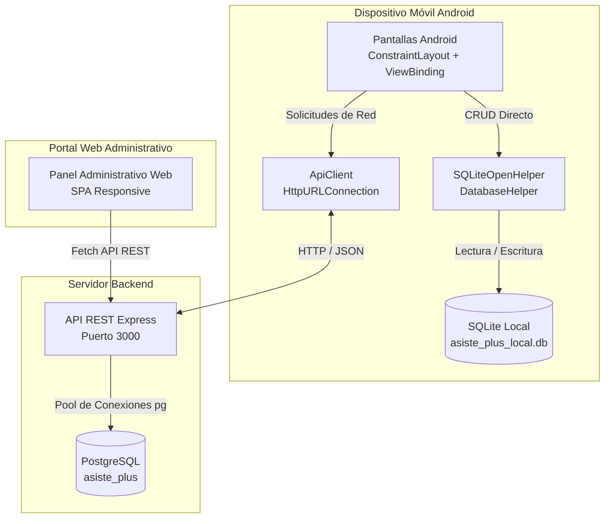
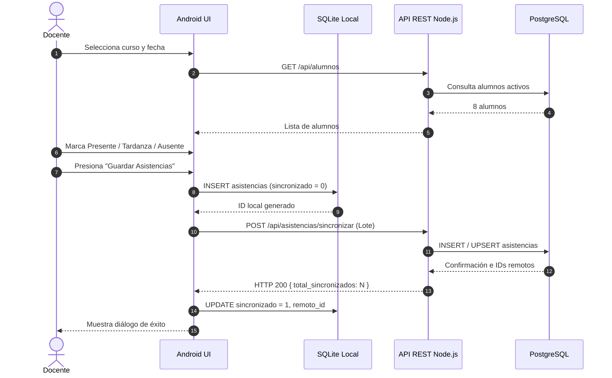

# Flujo de Información y Sincronización — Asiste+

Este documento describe la arquitectura de comunicación entre la aplicación móvil Android, la base de datos local SQLite, la API REST en Node.js y la base de datos central PostgreSQL.

---

## 1. Diagrama de Arquitectura de la Solución

---

## 2. Flujo 1: Registro de Asistencia con Conexión (Online)

1. El docente abre la aplicación móvil y selecciona un curso.
2. La aplicación consulta `GET /api/cursos` y `GET /api/alumnos`.
3. El docente marca la asistencia de la clase (Presente, Tardanza o Ausente).
4. **Persistencia Local Primero:** El registro se inserta en SQLite (`DatabaseHelper.insertarAsistencia`) con estado `sincronizado = 0`. Esto garantiza que un fallo de red repentino nunca pierda la toma de asistencia.
5. Inmediatamente, `ApiClient` envía el registro al endpoint `POST /api/asistencias/sincronizar`.
6. PostgreSQL confirma la transacción y retorna el `remoto_id`.
7. La aplicación actualiza el registro local a `sincronizado = 1` y almacena el `remoto_id`.
8. Se notifica al docente el éxito de la operación.

---

## 3. Flujo 2: Registro de Asistencia sin Conexión (Offline-First)

1. El docente se encuentra en un aula sin señal de red o sin WiFi.
2. La aplicación detecta la ausencia de conexión o el fallo de timeout.
3. Carga los cursos y alumnos disponibles desde la **caché local de SQLite**.
4. El docente registra la asistencia de sus estudiantes normalmente.
5. Todos los registros se guardan con seguridad en SQLite con la bandera `sincronizado = 0`.
6. La aplicación informa con un mensaje amigable: *"Guardado en SQLite local. Pendiente de sincronización"*.
7. Los registros quedan identificados con un distintivo visual naranja en la pantalla de Gestión Local.

---

## 4. Flujo 3: Recuperación de Conexión y Sincronización Diferida

1. Cuando el dispositivo vuelve a tener conectividad, el docente ingresa a **"Gestión Local SQLite"** o a **"Sincronizar Datos"** en la pantalla principal.
2. La aplicación invoca `dbHelper.listarPendientesSincronizacion()`, obteniendo únicamente aquellos registros con `sincronizado == 0`.
3. Envía el paquete JSON a `POST /api/asistencias/sincronizar`.
4. El servidor realiza un UPSERT seguro (`ON CONFLICT (alumno_id, curso_id, fecha) DO UPDATE`), evitando cualquier duplicación involuntaria.
5. El servidor responde con los identificadores asignados.
6. La base de datos SQLite se actualiza localmente marcando cada registro con `sincronizado = 1`.
7. El contador de pendientes desciende a 0.

---

## 5. Flujo 4: Resolución de Modificaciones y Eliminaciones

- **Modificación en SQLite:** Cuando un registro local se modifica (por ejemplo, justificación tardía de una inasistencia), su bandera pasa a `sincronizado = 0`. Al ejecutarse la sincronización, el servidor actualiza la fila correspondiente en PostgreSQL mediante la clave compuesta única `(alumno_id, curso_id, fecha)`.
- **Eliminación:** Los registros locales pueden eliminarse en SQLite mediante confirmación. En el portal administrativo web, los administradores pueden gestionar, modificar o eliminar registros directamente en la base de datos central.
